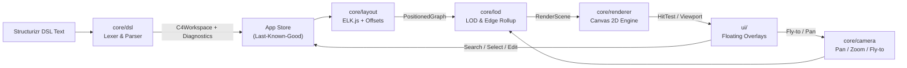

# c4-zoom 詳細設計書

本書は、C4 アーキテクチャモデルを地図アプリのように探索する Web アプリケーション **c4-zoom** のアーキテクチャおよび機能仕様を定義します。

---

## 1. プロダクトビジョンと設計思想

### 1.1 目指す体験
「システムアーキテクチャを、Google Maps や Apple Maps を眺めるように直感的に旅する体験」を実現します。

- **Architecture as Code をそのまま地図へ**: ユーザーは Structurizr DSL の `model` ブロックを書くだけでよく、`views` 定義を個別にメンテナンスしなくても 1 枚の探索可能な地図が自動生成される。
- **空間記憶（Spatial Memory）の活用**: ページ切り替え（別図へのジャンプ）ではなく 1 枚の連続空間に全階層を配置することで、「決済システムは南西、認証は北側」といった地理的感覚が定着し、隣のシステムの中身へそのまま横移動して比較できる。
- **情報過多の解消**: 広域では抽象化されたランドマークと幹線だけを見せ、ズームインした場所だけ細部が立ち上がる **セマンティック・ズーム（LOD）** と **エッジの動的ロールアップ** により、大規模構成でもスパゲッティ化を防ぐ。

### 1.2 スコープ（MVP）
- **対象形態**: ブラウザ完結型 Web アプリ（`pnpm` + Vite + React + TypeScript + Tailwind CSS v4）
- **入力**: Structurizr DSL コア構文サブセット（`.dsl` ファイルの D&D / ファイル選択読込・内蔵サンプルプリセット切替）
  - ※ **アプリ内での DSL エディタ機能はスコープ外**とし、探索ビューアとしての体験完成度に集中する
- **探索機能**:
  1. 連続セマンティック・ズーム＆慣性パン
  2. ズーム連動のエッジ自動集約（ロールアップ）＆選択時の上流・下流トレース
  3. スポット検索（`⌘K` / `/`）＆放物線 Fly-to カメラ移動
  4. ズームレベル計・現在地パンくず・リアルタイムミニマップ
  5. 詳細インスペクタパネル
  6. `.dsl` ファイル読込（画面 D&D / ファイル選択）・サンプル切替・診断表示
  7. ELK.js 階層自動レイアウト＋手動ドラッグ微調整の `localStorage` 永続化

### 1.3 Non-Goals（あえてやらないこと）と背景
MVP および現時点のプロダクト方針として、以下は意図的にスコープ外とします：

- **アプリ内での DSL エディタ機能**: 構文ハイライトや編集体験の作り込みに工数が分散するのを避け、「地図として探索する体験」の完成度に集中するため。DSL の編集はユーザーが普段使う IDE／エディタで行う前提とする。
- **GUI 作図エディタ（箱や線を直接描くツール）**: Architecture as Code（テキスト定義を Single Source of Truth とする）の利点を損なわないため。手動操作は「既存ノードの位置微調整」までに留める。
- **サーバーサイド処理・外部 API へのモデル送信**: ブラウザ完結の手軽さと、社外秘になりやすいアーキテクチャ構成をローカル環境外へ送らないプライバシーを保つため。
- **個別ビュー間のページ切り替え UI**: 既存ツール（Structurizr UI / LikeC4 等）と同じ土俵ではなく、1 枚の連続空間で空間記憶を活かせる体験に特化するため。

---

## 2. データモデル設計

### 2.1 正規化 C4 グラフモデル (`C4Model`)
DSL パーサーが出力する正規化モデルは以下の構造をとります。

```ts
export type ElementKind =
  | 'person'
  | 'softwareSystem'
  | 'container'
  | 'component'
  | 'group'
  | 'element';                // カスタム要素

export type C4Level = 1 | 2 | 3; // 1: Context, 2: Container, 3: Component

export interface C4Element {
  id: string;                 // DSL 識別子または正規化パスID（例: "shop.api.auth"）
  alias?: string;             // DSL 上の変数名（例: "authService"）
  kind: ElementKind;
  level: C4Level;             // group の場合は子要素のレベルに従う
  name: string;
  description?: string;
  technology?: string;
  url?: string;
  tags: string[];             // 例: ["External", "Database", "Queue"]
  properties: Record<string, string>;
  parentId: string | null;    // ルート要素は null
  childrenIds: string[];
  sourceRange?: SourceRange;  // DSL 上の定義位置（行・列）
}

export interface C4Relationship {
  id: string;
  sourceId: string;
  targetId: string;
  description?: string;
  technology?: string;
  tags: string[];
  properties: Record<string, string>;
  sourceRange?: SourceRange;
}

export interface C4Workspace {
  name: string;
  description?: string;
  elements: Record<string, C4Element>;
  rootIds: string[];
  relationships: C4Relationship[];
}
```

### 2.2 要素の視覚ロール判定
`kind` と `tags` / `technology` からカートグラフィー上のアイコン・形状を決定します。
- `person`: アクター（丸型バッジ＋人物グリフ）
- `softwareSystem`（`External` タグあり）: 外部領域（破線ボーダー・落ち着いたニュートラル配色）
- `softwareSystem`（内部）: 地区 / エリア（L1 ランドマーク兼 L2 コンテナの敷地）
- `container`: 建物 / ブロック（`Database` タグや PostgreSQL/MySQL/Redis 等の技術名でシリンダー・ストア装飾、`Queue`/`Broker` でストリーム装飾）
- `component`: 建物内のユニット / モジュール

---

## 3. 空間モデルと連続セマンティック・ズーム（LOD 設計）

### 3.1 座標系とカメラ変換
ワールド座標 `(wx, wy)` とスクリーン座標 `(sx, sy)` の変換を次式で定義します。

- ワールド → スクリーン:
  - $sx = (wx - cam.x) \cdot cam.zoom + viewport.width / 2$
  - $sy = (wy - cam.y) \cdot cam.zoom + viewport.height / 2$
- スクリーン → ワールド:
  - $wx = (sx - viewport.width / 2) / cam.zoom + cam.x$
  - $wy = (sy - viewport.height / 2) / cam.zoom + cam.y$

カメラのズーム範囲は `minZoom = 0.04`（超広域俯瞰）〜 `maxZoom = 12.0`（コンポーネント近接）とします。

### 3.2 画面占有サイズに基づくハイブリッド LOD 判定
単純な「グローバルズーム値」だけで全ノードを一律に切り替えると、大きいシステムと小さいシステムが混在したときに「まだ小さいのに中身が潰れて表示される」「十分大きいのに中身が開かない」問題が生じます。

そのため、c4-zoom では **各要素の「スクリーン上の見かけサイズ（`screenWidth`, `screenHeight`）」** を使って要素単位で連続的な展開度 `detailAlpha ∈ [0, 1]` を算出します。

```text
screenSize = min(node.width * zoom, node.height * zoom)
```

| 親ノードの `screenSize` | 状態 | 親ノードの描画 | 子ノードの描画 |
| :--- | :--- | :--- | :--- |
| `< 140px` | **Collapsed（収束）** | 不透明なランドマークカード。中央にアイコン・名前・説明・子要素数バッジを表示 | 非表示（または極めて淡い内部ブロックシルエット `alpha: 0.08` のみ） |
| `140px 〜 260px` | **Transitioning（展開中）** | 背景が徐々に半透明エリア（地区枠）へ変化し、タイトルが中央から左上ヘッダーへ滑らかに移行 | `detailAlpha = smoothstep(140, 260, screenSize)` に従いフェードイン |
| `> 260px` | **Expanded（展開完了）** | 淡いエリア塗り＋繊細なボーダー＋左上スティッキー風ヘッダーラベル | 完全表示（子ノード自身の `screenSize` に応じて孫ノードへ再帰適用） |

これにより、**画面の左にある大きなシステムは L2/L3 が見えていて、右にある小さな外部システムは L1 のランドマークのまま** という、本物の地図と同じ自然な多階層表現が成立します。

### 3.3 ズームレベル計（Context / Container / Component インジケータ）
画面左下のズームレベル計には、現在のビューポート中央付近で支配的に見えている階層を表示します。
- **L1: Context**（全体・システム俯瞰）
- **L2: Container**（システム内のアプリ・DB・キュー）
- **L3: Component**（コンテナ内のモジュール詳細）

インジケータ上の各レベルをクリックすると、選択中ノード（なければビューポート中央のノード）に対してそのレベルが最も見やすい倍率へ Fly-to できます。

---

## 4. 関係線（エッジ）の動的ロールアップ＆トレース

### 4.1 動的アンカー射影アルゴリズム（Dynamic Edge Rollup）
すべての定義済みエッジ（例：`Component A -> Container DB`）を、毎フレーム（またはズーム変化時にキャッシュ更新して）以下のように「現在見えている最も具体的な祖先ノード」へ射影します。

1. 各ノード `u` について、ルートから下っていき **「自身は表示されており、かつ親が展開済み（`detailAlpha >= 0.5`）である最深の祖先ノード」** を有効アンカー `anchor(u)` と定義する。
   - もしノード `u` 自身が可視であれば `anchor(u) = u`。
   - 親システムがまだ閉じている（`detailAlpha < 0.5`）なら、`anchor(u)` はその親システムになる。
2. 元のエッジ `(s, t)` を `(A, B) = (anchor(s), anchor(t))` に変換する。
3. **自己ループ除去**: `A === B` の場合（例：同じ閉じたシステム内部の通信）は、外部へ漏らさず非表示とする（そのシステムにズームインして展開された瞬間に内部エッジとして出現する）。
4. **集約（Rollup）**: 同一の有向ペア `(A, B)` に射影された複数の元エッジを 1 本の集約エッジ `DisplayEdge` にまとめる。
   - `big-bank-plc.dsl` のように「親レベルに直接定義された関係線（例：`customer -> internetBankingSystem`）」と「子レベルからロールアップされた関係線（例：`customer -> webApplication` 等）」の両方が同一ペア `(A, B)` に射影される場合も、1 本の `DisplayEdge` へ自然に統合し、インスペクタ上で内訳を確認できるようにする。
   - `count`: 集約された元エッジ本数
   - `underlyingIds`: 元の `C4Relationship.id` 配列
   - `technologies`: 重複排除した技術・プロトコル一覧（例：`HTTPS, gRPC`）
   - `summaryLabel`: 1 件なら元エッジの `description`、複数件なら親直接エッジの説明を優先（なければ代表説明または `N connections`）＋技術バッジ
5. **双方向分離**: `(A, B)` と `(B, A)` が両方存在する場合は、ベジェ曲線の制御点を法線方向へオフセットして重なりを防ぐ。

### 4.2 上流・下流トレース（選択時フォーカス）
あるノード `X`（またはエッジ）をクリックして選択した際の挙動：
- **直接接続＋推移的依存の分類**:
  - **Upstream（上流 / 呼び出し元・流入）**: `X`（および `X` の子孫）へ到達する経路をインディゴ／ブルー系で強調
  - **Downstream（下流 / 依存先・流出）**: `X`（および `X` の子孫）から伸びる経路をエメラルド／ティール系で強調
  - （インスペクタ上のトグルで「直接接続のみ（1-hop）」と「全到達経路（Transitive）」を切替可能）
- **ディミング**: 選択ノードおよび関連経路以外のノード・エッジは不透明度を `0.18` まで落とし、依存構造を瞬時に浮かび上がらせる。
- **方向アニメーション**: 強調されたエッジ上を、データの流れを示す繊細なパルスドットが `source -> target` 方向に流れる。

---

## 5. ハイブリッドレイアウトエンジン設計

### 5.1 階層自動レイアウト（ELK.js）
C4 の入れ子構造は複合グラフ（Compound Graph）そのものであるため、`elkjs` の階層レイアウト機能（`elk.hierarchyHandling: 'INCLUDE_CHILDREN'`、`elk.algorithm: 'layered'`）を採用します。

- **パディングとヘッダー余白**: 子を持つ要素には、展開時のヘッダーラベル領域（上部 `48px` 相当）と周囲パディングを確保し、子要素がヘッダーに重ならないようにする。
- **サイズ設計（スケール比の最適化）**:
  - Component 基本サイズ: `180 × 84`
  - Container（子なし）基本サイズ: `220 × 104` / （子あり）: 子領域のバウンディングボックス＋パディングから自動算出
  - System（子なし）基本サイズ: `280 × 130` / （子あり）: 子コンテナ群のバウンディングボックス＋パディングから自動算出
  - Person 基本サイズ: `180 × 110`
- **非同期実行**: 大規模モデルのレイアウト計算で UI をブロックしないよう、`elkjs` は Web Worker（または非同期 Promise）で実行し、読込中は現在の地図を維持し、新しいモデルの配置が成功したら全体が収まる位置に切り替える。

### 5.2 手動位置微調整と空間記憶の永続化
- **保存データ構造**: 絶対座標ではなく「自動レイアウト結果からの相対オフセット差分」を保持する。
  ```ts
  interface LayoutOverrides {
    workspaceHash: string; // ワークスペース識別用
    offsets: Record<string, { dx: number; dy: number }>;
  }
  ```
- **誤ドラッグ防止**:
  - 通常ドラッグは「地図のパン（移動）」に専念させる（地図アプリとしての手触りを最優先）。
  - 要素を移動したい場合は、ツールバーの「配置調整モード（Edit Layout）」を ON にするか、`Alt / Option + ドラッグ` で移動できる設計とする。
  - 親ノードを動かすと子孫も一体で追従し、子ノードを動かすと親のバウンディングボックスが必要に応じて自動拡張される。
- **リセット**: インスペクタまたはツールバーから「この要素の位置をリセット」「全レイアウトをリセット」を実行可能。

---

## 6. カメラ制御とインタラクション仕様

### 6.1 地図アプリ準拠の操作感
- **パン**: 左ドラッグ（またはスペース＋ドラッグ）、トラックパッド2本指スワイプ。ドラッグ終了時に短い減衰慣性（Inertia）を適用してヌルッとした止まり方にする。
- **ズーム**:
  - マウスホイール / トラックパッドピンチ（`ctrlKey` 付きホイールイベント）で、**カーソル直下のワールド座標を固定点として** 滑らかにズーム。
  - ズーム操作にもわずかなスムージング補間を入れ、ステップ感のあるガクつきをなくす。
- **ダブルクリック**:
  - ノード上でダブルクリック → そのノードが画面の約 65% に収まる倍率へ **Fly-to**。
  - すでに展開済みのノードの背景をクリックせずダブルクリックした場合は一段階深くフォーカス。

### 6.2 放物線 Fly-to アニメーション
スポット検索やパンくずクリックで遠くのノードへ移動する際、単純な線形補間だと「ズームしたまま高速に横滑りして酔う」現象が起きます。
Google Maps / Mapbox と同様の **Van Wijk & Nuij 方式（または簡易放物線ズーム軌道）** を採用し、移動距離が大きいほど **一度わずかにズームアウトして全体を見せてから目的地へズームインする** 気持ちよいカメラ移動（約 `550ms〜850ms`、Cubic Ease-In-Out）を実装します。ユーザー操作（ホイール・ドラッグ）が入ったら即座にアニメーションをキャンセルして主導権を返します。

### 6.3 キーボードショートカット
| キー | 動作 |
| :--- | :--- |
| `⌘K` / `Ctrl+K` / `/` | スポット検索バーへフォーカス |
| `0` | 地図全体が収まる俯瞰ビューへ Fit（Fly-to） |
| `+` / `-` | 画面中央基準でズームイン / ズームアウト |
| `1` / `2` / `3` | 現在のフォーカス領域を L1 / L2 / L3 推奨倍率へズーム |
| `O` | `.dsl` ファイル選択ダイアログを開く |
| `Esc` | 検索閉じ / ポップオーバー閉じ / ノード選択解除 |

---

## 7. ビジュアルデザイン仕様（モダン・カートグラフィー）

Apple Maps / Mapbox の清潔感と情報設計をソフトウェアアーキテクチャに翻訳します。

### 7.1 テーマとカラーシステム（ライト基調 + ダーク切替対応）
MVP は明るく澄んだ **Cartography Light** をデフォルトとし、トークン設計により **Cartography Dark** への切替を容易にします。

- **キャンバス背景**: 温かみのある極薄スレート（`#F4F6F8`）＋ズーム倍率に応じて間隔が自動調整される微細な地図グリッド（`#E2E8F0`）
- **System（内部・地区）**: 淡いブルーグレーの敷地（`#EEF4FB`）、落ち着いたスレートブルー境界（`#93B4D8`）、展開時は左上にピル型エリアラベル
- **System（外部）**: 淡いウォームグレー（`#F1F2F4`）＋破線ボーダー（`#94A3B8`）
- **Person（ユーザー / アクター）**: ソフトインディゴのアクセント（`#EEF2FF` / `#6366F1`）
- **Container（建物ブロック）**: 純白カード（`#FFFFFF`）＋繊細な標高シャドウ（Elevation Shadow）＋種別アクセント左帯（API: ティール、Web/Mobile: ブルー、DB: アンバー、Queue: パープル）
- **Component（内部ユニット）**: クリーンなオフホワイト（`#F8FAFC`）＋細線枠（`#CBD5E1`）＋技術タグ
- **関係線（道路網）**:
  - 通常時: 控えめなクールグレー（`#94A3B8`、線幅は集約件数に応じて対数的に太く `1.5px 〜 4px`）
  - 集約バッジ: 線の中心に白抜きピルでプロトコルや件数を表示
  - トレース強調時: 上流 `#4F46E5`（インディゴ）、下流 `#0D9488`（ティール）

### 7.2 画面レイアウト（フローティングオーバーレイ）
地図キャンバスを常に **画面 100%（フルブリード）** に広げ、UI コントロールはガラス調のフローティングパネルとして四隅に配置します。

```text
┌────────────────────────────────────────────────────────────────────┐
│ [🔍 Search spots (⌘K)...]  [🌐 Workspace > Shop > API] [Sample][📂]│
│                                                                    │
│                                                      ┌───────────┐ │
│                                                      │ Inspector │ │
│                      Full-bleed                      │ (Selected │ │
│                 HTML5 Canvas 2D Map                  │  Node /   │ │
│             (Drop .dsl file anywhere)                │  Trace)   │ │
│                                                      └───────────┘ │
│                                                                    │
│ [L1|L2|L3] [+][-][Fit][Layout][☀/🌙]                ┌─────────────┐ │
│                                                    │   Minimap   │ │
└────────────────────────────────────────────────────┴─────────────┘
```

- **左上**: スポット検索バー（インクリメンタル検索：名前・説明・技術・タグにヒット、↑↓＋Enter で即 Fly-to）＋ ビューポート現在地パンくず
- **右上**: サンプルプリセット切替ドロップダウン、`.dsl` ファイル読込ボタン（画面全体 D&D にも対応）、パース警告／エラーがある場合の診断バッジ＆ポップオーバー
- **左下**: ズームレベル計（L1/L2/L3）＋ ズームボタン / 全体フィット / レイアウト微調整モード切替 / テーマ切替
- **右下**: リアルタイムミニマップ（クリック＆ドラッグでカメラ移動可能）
- **右パネル（選択時表示）**: 選択ノード/エッジの詳細（種別・技術・説明・タグ・プロパティ・外部 URL）、上流・下流の接続先リスト（クリックで相手先へ Fly-to）

---

## 8. モジュール構成とデータフロー



### パフォーマンス方針
- **フラスタムカリング（Viewport Culling）**: 現在のビューポート矩形外にあるノードおよびエッジは描画をスキップ。
- **エッジロールアップのメモ化**: ズームレベル帯域および各ノードの展開状態ハッシュが変わらない限り（純粋なパン操作中など）、集約エッジリストを再計算せずキャッシュを再利用する。
- **ラベル衝突回避**: スクリーン空間での簡易グリッド／矩形重なりチェックにより、エッジラベル同士が重なって読めなくなるのを防ぐ（選択中・ホバー中エッジを最優先）。
- **HiDPI 対応**: `window.devicePixelRatio` に合わせてキャンバス解像度をスケーリングし、Retina ディスプレイでも文字と線を極限までシャープに保つ。

---

## 9. 永続化とエラーハンドリング

- **状態管理**: React Context + `useReducer` で UI 状態を管理し、60fps で更新されるカメラ・アニメーション・ホバー等の高頻度状態は `Ref` に隔離して React 再レンダリングを防ぐ。
- **ブラウザ自動保存 (`localStorage`)**:
  - 最後に選択したサンプルプリセットまたは読み込んだ `.dsl` テキスト
  - ワークスペースごとの手動レイアウトオフセット
  - UI 設定（テーマ等）
- **ファイル入力**:
  - 画面上への `.dsl` ファイルドラッグ＆ドロップ読み込み
  - ファイル選択ダイアログからの読み込み
- **エラー耐性**:
  - 読み込んだ `.dsl` に構文エラーがある場合は、行・列番号と理由を診断ポップオーバー／トーストに表示しつつ、地図キャンバスは直前の正常モデル（Last-Known-Good）をそのまま維持して操作を妨げない。
